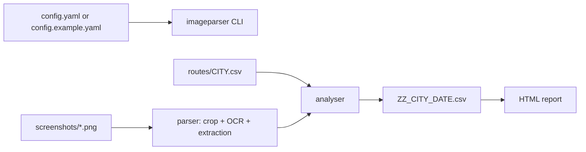

# Design Document — ImageParser

## Purpose and data flow

ImageParser reads a route CSV and existing screenshots, applies configured
OCR to selected image regions, and writes a result CSV. The report module can
turn one or more result CSVs into standalone HTML:

Device control and screenshot capture are not part of the current application.

## Package map

| Module | Responsibility |
|--------|----------------|
| `imageparser/cli.py` | Configuration, screenshot analysis, and report command dispatch |
| `imageparser/config.py` | YAML → configuration dataclasses and config-file lookup |
| `imageparser/constants.py` | OCR crop profiles, fare labels, and result CSV columns |
| `imageparser/naming.py` | Legacy city-prefix handling and screenshot file paths |
| `imageparser/routes.py` | Loading route rows used to associate screenshots with addresses |
| `imageparser/analysis/engines.py` | OCR interface and EasyOCR/PaddleOCR/Tesseract back-ends |
| `imageparser/analysis/parser.py` | Per-image crop, OCR dispatch, and field extraction |
| `imageparser/analysis/analyser.py` | Route/app screenshot batch processing and CSV output |
| `imageparser/text_utils.py` | OCR text-to-number, fare, and map-summary parsing |
| `imageparser/report.py` | Result CSVs → self-contained HTML reports |

## Screenshot and result contract

Screenshots are named `<CITY><DATE><ID:03d><SUFFIX>.png` and stored in
`<work_base>/screenshots/<DATE>_<CITY>_<PHONE>/`. Supported fare groups are
`B`/`BI` (Bolt), `D`/`DI` (DiDi), and `UX`/`UXI` (UberX). `UX1` is an
alternative UberX fare image. `G` contains map distance and duration; `G0` and
`G1` are alternatives. When an app group is present in the run, the output
contains a row for each route for that group. Corrected files under `dc/`
take precedence over their matching originals.

`ScreenshotParser` extracts fields from individual images.
`ScreenshotAnalyser` loads route rows and writes fields in `RESULT_FIELDS`
order. Alternative Google images are read in place and are not renamed.
OCR libraries are loaded lazily; `create_engine("auto")` tries EasyOCR,
PaddleOCR, then Tesseract.

## Configuration

Configuration lookup order is explicit `--config`, `IMAGEPARSER_CONFIG` (or
legacy `APPAUTOMATION_CONFIG`), `config.yaml` in the current directory, then
the bundled `config.example.yaml`. Analysis uses `work_base`, `ocr_engine`,
`ocr_gpu`, `tesseract_cmd`, and the selected phone's screen profile. Retained
device and email configuration fields are compatibility-only and are not used
in image analysis.
